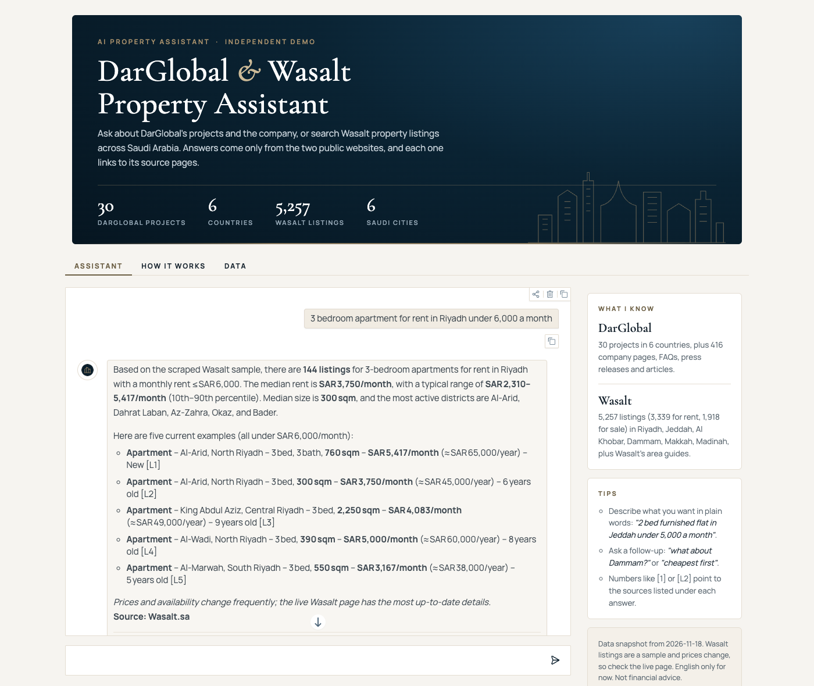
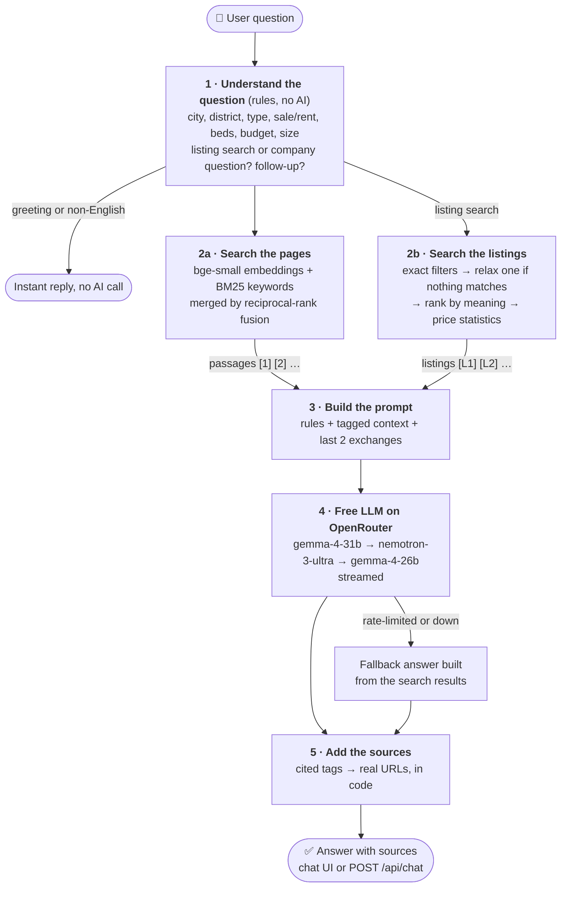
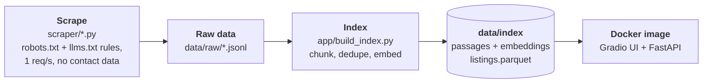
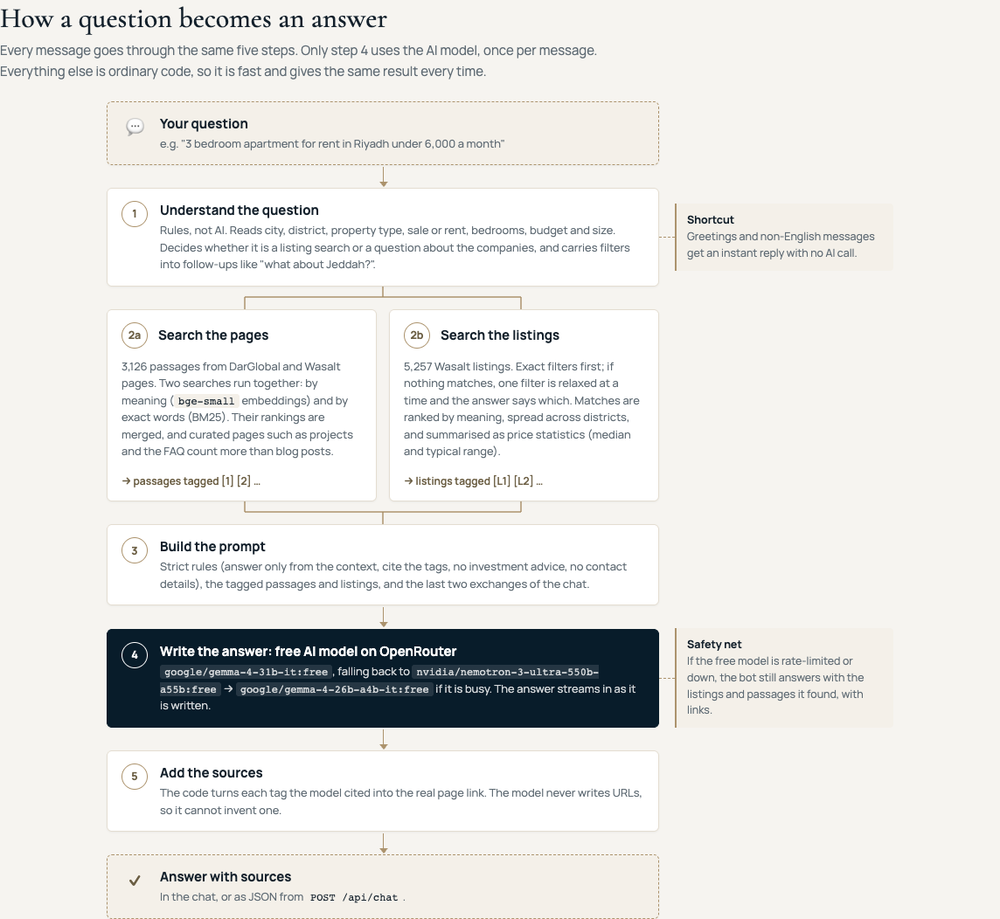

# DarGlobal & Wasalt Property Assistant

An AI chatbot that answers questions about **DarGlobal** (projects, company, FAQs, press, blog) and searches
**Wasalt** property listings in Saudi Arabia. It uses only public data scraped from darglobal.co.uk and wasalt.sa,
and it cites the source page for every answer.

- **Live demo:** https://thecoderhere-darglobal-ai-assistant.hf.space
- **API:** `POST https://thecoderhere-darglobal-ai-assistant.hf.space/api/chat` with `{"message": "..."}` ·
  health check: [`GET /health`](https://thecoderhere-darglobal-ai-assistant.hf.space/health)
- **LLM:** free models on OpenRouter (`google/gemma-4-31b-it:free`, falling back to `nvidia/nemotron-3-ultra-550b-a55b:free`
  and `google/gemma-4-26b-a4b-it:free`)
- **Container:** a single Docker image (`Dockerfile`) that holds the app, the data and the search index



Example questions to try:

| DarGlobal | Wasalt |
|---|---|
| Which DarGlobal projects are in Oman? | 3 bedroom apartment for rent in Riyadh under 6,000 a month |
| Tell me about DG1 in Dubai | Villas for sale in North Jeddah under 3 million |
| Which luxury brands has DarGlobal partnered with? | What do lands for sale in Dammam typically cost? |
| Is DarGlobal listed on a stock exchange? | …then a follow-up: *what about Madinah?* |

## How it works

**Per question** (only step 4 calls the AI model, once per message):



**Once, before deployment** (the index is built during `docker build`):



The app itself has three tabs: the chat, a **How it works** page with this flow, and a **Data** page with
what was scraped.



**Design choices**

- **One LLM call per message.** Listing filters come from a deterministic parser, not an LLM "tool call". It is
  instant and unit-tested, and it doubles how many questions the free-tier quota can serve.
- **Hybrid retrieval.** Embeddings catch meaning ("tax-free investment"), BM25 catches exact names ("DG1",
  "Al Nakheel"). Reciprocal-rank fusion combines them without tuning weights.
- **Structured search for listings.** "Under 6,000 a month in Riyadh" is a filter problem, not a similarity
  problem. Listings are filtered exactly, then ranked semantically. If nothing matches, filters are relaxed one at
  a time and the answer says which one was relaxed.
- **Price statistics** (median and range over the matching sample) answer "how much does X cost" questions honestly,
  labelled as a sample.
- **Citations are built in code.** The model cites tags like `[2]` or `[L1]`, and the app maps them to real URLs, so a
  link can't be invented.
- **The bot keeps answering when the free model doesn't.** Greetings and non-English messages need no LLM. If
  OpenRouter is rate limited or down, the bot shows the retrieved listings and passages with links instead of an
  error. The free models are tried in order through OpenRouter's `models` fallback.
- **Small image.** ONNX embeddings (`fastembed`, no PyTorch). The index is built at `docker build` time from the raw
  JSONL, so the container starts in seconds and the image is reproducible.

## Data

Snapshot scraped on **18 Nov 2026**:

| Source | What | Count |
|---|---|---|
| DarGlobal | Project pages with structured fields (location, type, status, unit types, sizes, amenities, nearby landmarks) | 30 projects in the UAE, Oman, Saudi Arabia, Qatar, Spain and the UK |
| DarGlobal | Company pages (About, FAQ, Investor, AIDA 360, Why invest, ...) | 59 |
| DarGlobal | Blog / press / insights articles | 264 / 68 / 26 |
| Wasalt | Listings: Riyadh, Jeddah, Dammam, Al Khobar, Makkah, Madinah (475 districts) | 5,257 (3,339 rent · 1,918 sale) |
| Wasalt | Area guides with FAQs, company pages | 101 |
| Index | Searchable text chunks (plus one embedding per listing) | 3,126 |

**The scraped data is not committed to this repository.** Wasalt's `llms.txt` forbids redistributing its data, so the
snapshot lives only inside the deployed container (and in a private dataset the deployment is built from). To
rebuild it, run the scrapers (about 20 minutes, see below).

**How it was collected**

- **DarGlobal (darglobal.co.uk):** every page in `sitemap.xml` except forms, legal pages, careers and campaign
  landing pages. Pages are Next.js, so content is read from the embedded CMS JSON (`__NEXT_DATA__`) rather than the
  rendered HTML: no navigation noise, and project pages yield structured fields (location, type, status, unit
  types, sizes, amenities, nearby landmarks).
- **Wasalt (wasalt.sa):** public category pages from Wasalt's category sitemap (city, region and a seeded sample of
  district pages across 6 cities, apartments, villas, floors, land and commercial, for sale and rent). Each page
  embeds up to 32 listings as JSON. City-level pages also contribute Wasalt's area guide and FAQ text.

**Scraping rules followed**

- `robots.txt` checked for every URL. Wasalt's `/search` is never requested.
- Wasalt's [`llms.txt`](https://wasalt.sa/llms.txt) allows extracting public listing content and summarising it. In
  line with it, **no phone numbers, WhatsApp links, owner or agent details are stored** (listing fields are copied
  from a whitelist), answers say "Source: Wasalt.sa" and link the live listing, and users are told prices change.
- About 1 request per second with an honest bot User-Agent. Responses are cached so nothing is fetched twice.
- `blog.wasalt.sa` returns 403 to scripts, so it was **not** scraped.
- The listing URLs in Wasalt's product sitemap are mostly stale (404). Category pages render only their first page
  server-side (paging goes through the disallowed `/search`), so coverage comes from many district pages instead.

## Run it

**1. Scrape the data** into `data/raw/` (it is not in the repository; see Data):

```bash
pip install -r scraper/requirements.txt
cd scraper && python scrape_darglobal.py && python scrape_wasalt.py && cd ..   # about 20 minutes
```

**2. Build and run the container**, or run it with plain Python:

```bash
docker build -t property-assistant .            # also builds the search index
docker run -p 7860:7860 -e OPENROUTER_API_KEY=sk-or-... property-assistant
# open http://localhost:7860

# without Docker (Python 3.12+)
pip install -r requirements.txt
python app/build_index.py
OPENROUTER_API_KEY=sk-or-... python app/main.py
```

**3. Deploy.** The live demo is a Hugging Face Docker Space built from this `Dockerfile`. A Space repository is
public, so it holds only the code; the build reads the scraped data and the prebuilt index from a **private**
Hugging Face dataset, named by the Space variable `DATA_REPO`, using the Space secret `HF_TOKEN`
(see `app/prepare_data.py`). The OpenRouter key is the Space secret `OPENROUTER_API_KEY`. Any other Docker host
works the same way, with `data/raw/` filled before `docker build`.

Tests and evaluation:

```bash
pytest -q tests                      # query-parser unit tests
python eval/run_eval.py              # 22 questions → eval/results.md
python eval/run_eval.py --url <live-url>
```

## Evaluation

22 questions in `eval/questions.json` cover DarGlobal projects and company facts, Wasalt listing searches (filters,
price statistics, a follow-up question) and guardrails (off-topic, non-English, an unanswerable question, an
investment-advice request).

**Live deployment, 19 Nov 2026: 22/22 passed**, median latency 7.3 s, and the no-LLM fallback was not needed.
Each check means an answer came back, it contains an expected fact (for example the CEO's name, or Oman project
names) and it has a Sources section (guardrail replies excepted). Every question and full answer is in
[`eval/results.md`](eval/results.md). Two questions were re-run after network errors on the test machine.

## Limitations

- **Snapshot data.** Prices and availability change. Every listing links to its live Wasalt page.
- **Wasalt listings are a sample**, so price statistics describe the sample, not the whole market.
- Some Wasalt listings contain owner-entered errors (for example an apartment listed at 1,590 sqm). They are kept
  as published.
- **Free-model limits.** OpenRouter's free models have per-minute and per-day request caps, so busy periods may
  trigger the no-LLM fallback answer.
- English only for now.

## What I would do next

- Scheduled re-scrape (for example a nightly GitHub Action) and incremental index updates
- Arabic support: Arabic pages from both sites plus a multilingual embedding model
- A cross-encoder re-ranker, and an LLM-judged evaluation set with ground-truth answers
- Lead hand-off: "book a viewing" captures intent and routes to the official CRM, never storing personal data in the bot

## Project layout

```
scraper/   common.py · scrape_darglobal.py · scrape_wasalt.py
data/raw/  darglobal_pages.jsonl · darglobal_projects.jsonl · wasalt_listings.jsonl · wasalt_pages.jsonl
app/       config.py · normalize.py · build_index.py · query_parser.py · retriever.py · llm.py · bot.py
           main.py (web app + API) · ui.py (theme, How it works and Data pages) · static/
           prepare_data.py (Docker build step: data, index, embedding model)
tests/     test_query_parser.py
eval/      questions.json · run_eval.py · results.md
docs/      screenshots
```

_Demo built for a technical assessment. Not affiliated with or endorsed by DarGlobal or Wasalt. Not financial advice._
